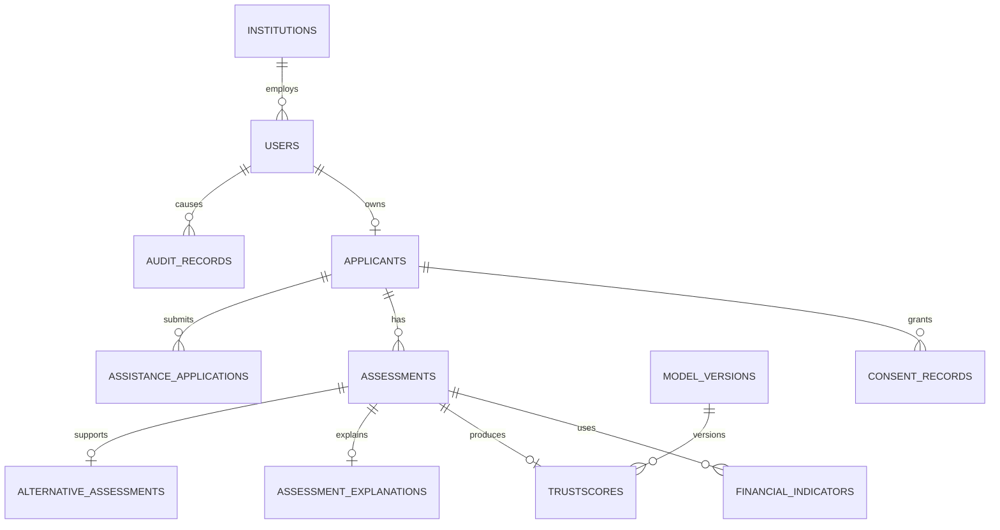

# Database Schema

## Design principles

Use a relational schema with UUID primary keys, UTC timestamps, explicit status fields, foreign keys, and migrations. Store the minimum personal data needed for the prototype. Keep identity data separate from assessment features and never use raw identifiers as model inputs.

SQLite is suitable for the local demo; the schema should remain compatible with PostgreSQL for a later deployment.

## Entities

### `users`

`id`, `email_or_login`, `password_hash`, `role`, `institution_id` (nullable), `status`, `created_at`, `last_login_at`.

Roles include applicant, institution_reviewer, programme_admin, and system_admin. Use a separate institution relation for tenant isolation.

### `applicants`

`id`, `user_id`, `display_name`, `country_code`, `identity_status`, `created_at`, `updated_at`, `deleted_at`.

Avoid storing raw National ID values. A simulated provider reference, if needed, must be non-sensitive and clearly synthetic.

### `institutions`

`id`, `name`, `country_code`, `status`, `created_at`.

### `consent_records`

`id`, `applicant_id`, `purpose`, `policy_version`, `categories`, `status`, `granted_at`, `withdrawn_at`, `expires_at`, `source`.

Consent is purpose-specific and versioned. It is not a blanket permission for restricted data.

### `financial_indicators`

`id`, `applicant_id`, `assessment_id`, `indicator_type`, `value_or_bucket`, `source_type`, `verification_status`, `observed_period`, `recency`, `missing_reason`, `created_at`.

Use controlled values or buckets in the prototype. Do not store raw account/card data. A record may be absent, unavailable, stale, contradictory, or verified; these states must be distinct.

### `assessments`

`id`, `applicant_id`, `country_config`, `pathway`, `status`, `evidence_sufficiency`, `started_at`, `completed_at`, `created_at`.

`pathway` is one of `trustscore`, `alternative`, or `assisted_access`.

### `trustscores`

`id`, `assessment_id`, `score_0_1000`, `benchmark_reference`, `model_version_id`, `calibration_version`, `generated_at`, `limitations`.

There must be no TrustScore row for an insufficient-evidence assessment.

### `model_versions`

`id`, `name`, `algorithm`, `country_code`, `dataset_version`, `feature_schema_version`, `artifact_ref`, `evaluation_ref`, `status`, `created_at`.

### `assessment_explanations`

`id`, `assessment_id`, `summary`, `principal_factors`, `evidence_gaps`, `generated_at`.

### `alternative_assessments`

`id`, `assessment_id`, `verification_steps`, `outcome`, `referral_type`, `notes`, `created_at`.

### `assistance_applications`

`id`, `applicant_id`, `eligibility_status`, `requested_amount`, `approved_amount`, `funding_source`, `decision_reason`, `created_at`, `decided_at`.

This is a separate programme record and must not influence a TrustScore automatically.

### `audit_records`

`id`, `actor_user_id`, `event_type`, `entity_type`, `entity_id`, `purpose`, `result`, `metadata_redacted`, `created_at`.

Audit metadata must not contain secrets or raw sensitive payloads.

## Relationships

## Retention and deletion

Assessment and consent retention must be policy-driven and documented. Deletion or anonymisation must cover derived records and exports, subject to legally required audit retention. The prototype should provide a demonstrable deletion/anonymisation command and tests rather than claiming automatic deletion without one.

## Integrity rules

- No assessment may bypass consent requirements.
- No score may be generated for insufficient evidence.
- A withdrawn consent cannot be used for new data access.
- Institution users can access only authorised institution records.
- Assistance decisions cannot mutate loan or score decisions.
