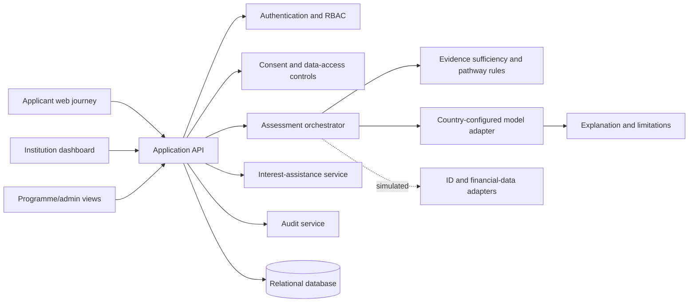

# Technical Architecture

## Recommendation

The approved GIC demonstration frontend is implemented as a Flutter mobile app. The original web/API recommendation below remains the future integration direction; it is not part of the offline mobile demo.

Build the first demonstration as a modular monolith with a responsive web UI, a typed HTTP API, and a relational database. This keeps the GIC demonstration understandable and testable while leaving clean seams for later provider adapters and model services.

Recommended future stack:

- Frontend: React + TypeScript + Vite, with accessible component styling.
- Backend: Python + FastAPI, Pydantic validation, and SQLAlchemy.
- Database: SQLite for local demonstration, with PostgreSQL-compatible schema and migrations for later deployment.
- AI/ML: Python, pandas, scikit-learn, and SHAP or model-native feature importance where appropriate.
- Testing: pytest for backend/model tests; Vitest and Testing Library for frontend tests; Playwright only for a small critical journey if setup time permits.
- Packaging: one repository with separate `frontend/`, `backend/`, `ml/`, and `docs/` areas. Pin dependencies once implementation starts.

Current demonstration frontend:

- Flutter/Dart with Material 3 and a custom OpenCred design system;
- bundled synthetic CSV assets and a deterministic in-memory demo state;
- mock identity, consent, assessment, institution review, assistance, and status surfaces;
- no network dependency and no real National ID, bank, government, or AI provider.

These are recommendations, not installed dependencies. No dependency should be added before implementation approval and a concrete need.

## Logical components

## Main request flows

### Applicant assessment

1. Applicant creates a minimal account.
2. The system runs a simulated identity verification and records its status without storing unnecessary ID values.
3. The applicant reviews purposes, categories, retention, withdrawal, and limitations; explicit consent is recorded.
4. The system retrieves synthetic evidence through a provider interface.
5. Evidence sufficiency rules select Pathway 1, Pathway 2 alternative assessment, or assisted access.
6. Pathway 1 invokes the configured model and calibrates output to 0–1,000.
7. The system stores model version, evidence summary, explanation, and limitations.
8. Applicant and institution views show only role-appropriate information.

### Institution review

Institutions view a supplementary assessment, evidence status, explanation, model version, and warnings. They must record that their own affordability and lending process remains authoritative. The prototype must not include a “approve loan” action.

### Interest assistance

The assistance module is separate from lending assessment. It accepts a fictional application, applies transparent prototype eligibility rules, records a decision and funding allocation, and displays the programme's limits and audit trail.

## Backend module boundaries

- `auth`: sessions/tokens, password policy, roles.
- `applicants`: minimal profile and lifecycle.
- `consent`: purpose-specific consent, version, timestamps, withdrawal.
- `providers`: interfaces plus simulated ID and financial-data adapters.
- `assessment`: evidence quality, pathway selection, orchestration.
- `trustscore`: model loading, calibration, score and explanation contract.
- `institutions`: institution users and assessment access.
- `assistance`: eligibility, allocation, and programme separation.
- `audit`: immutable-style event records and access events.
- `retention`: deletion/anonymisation jobs and policy checks.

## Country adaptation

Country configuration should declare permitted indicator types, required consent language, model version, evidence rules, and feature availability. A country key is configuration, not proof of legal compliance. Each future deployment requires local data, regulatory review, partnerships, calibration, and independent fairness validation.

## Prototype versus future integration

| Capability | Prototype | Future deployment |
|---|---|---|
| National ID | Simulated pass/fail/pending provider | Authorised provider under legal agreement |
| Financial data | Synthetic records | Permitted institutional APIs/files |
| Model | Local synthetic training | Locally validated production model |
| Lending | Review-only dashboard | Institution-owned workflow and compliance |
| Assistance funds | Fictional ledger | Segregated, governed funding arrangement |

## Non-functional requirements

The prototype should be usable on a normal laptop, have deterministic demo data, expose clear errors, maintain role isolation, log sensitive operations, and make all simulated integrations visible in the UI. Production targets such as uptime, throughput, and predictive accuracy are intentionally not claimed yet.
